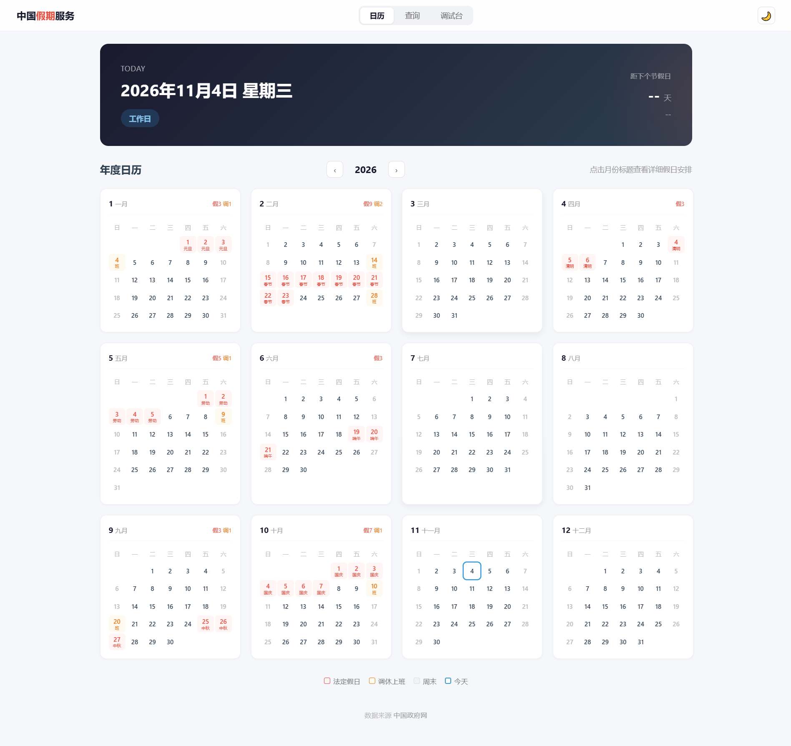
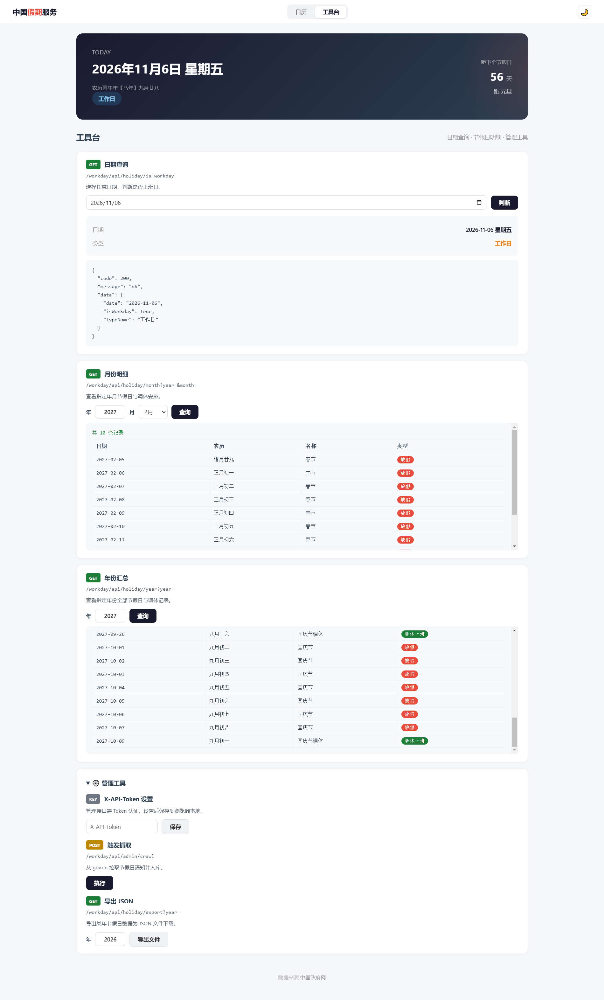

# china-workday

法定节假日 / 中国节假日 / 工作日判断公共服务（Spring Boot 3.2.5 / Java 17）。

- **坐标**：`com:china-workday:1.0.0`，包名 `com.ict.workday`
- **功能**：从国务院官方搜索数据接口（gov.cn「政策文件库」）获取「部分节假日安排的通知」，解析放假与调休日期入库，提供 HTTP 接口判断某日是否上班日，支持按年份导出 JSON 离线使用。
- **数据库**：支持 PostgreSQL 与 H2 内嵌数据库，通过 Spring profile 随时切换。
- **代码仓库**：Gitee ｜ **发布仓库**：阿里云效 Packages（Maven）

> **抓取源说明**：gov.cn 政策文件库列表页（`/zhengce/zhengceku/`）对部分网络环境返回 403 且为 JS 动态渲染。本项目改用其**官方搜索 JSON 数据接口**（`sousuo.www.gov.cn/search-gov/data`，`type=gwyzcwjk` 政策文件库检索）获取各年份通知详情 URL，再抓取详情页解析。搜索接口返回失败时自动回退为列表页抓取。

## 快速开始（本地）

要求：JDK 17、Maven 3.6+。

### 方式一：H2 内嵌数据库（无需安装，推荐）

```bash
# 只需一行命令，无需 PostgreSQL
mvn spring-boot:run -Dspring-boot.run.profiles=h2
```

首次启动会自动创建 `./data/china-workday.mv.db` 文件数据库并从 gov.cn 抓取节假日数据。

H2 控制台访问：<http://localhost:8080/workday/h2-console>

**数据库文件目录**可通过环境变量 `H2_DB_DIR` 指定（默认当前目录下的 `data/`）：

| 运行方式 | 默认目录 | 示例 |
|---|---|---|
| `mvn spring-boot:run` | 项目根目录的 `data/` | `mvn spring-boot:run -Dspring-boot.run.profiles=h2` |
| `java -jar app.jar` | 执行 jar 所在目录的 `data/` | `java -jar china-workday.jar --spring.profiles.active=h2` |
| Docker | 容器内 `/app/data/`（需挂载 volume 持久化） | 见下方 Docker H2 说明 |

### 方式二：PostgreSQL

```bash
# 1. 建库（假设本机 PG 已启动）
createdb chinaworkday -U chinaworkday   # 或用 deploy/db/init-user-db.sh

# 2. 配置（环境变量）
export DB_USER=chinaworkday
export DB_PASSWORD=chinaworkday
export DB_URL=jdbc:postgresql://localhost:5432/chinaworkday
export CHINA_WORKDAY_API_TOKEN=your-token

# 3. 运行（本地连 PG，使用 dev profile）
mvn spring-boot:run -Dspring-boot.run.profiles=dev
```

启动后访问：<http://localhost:8080/workday/>

## 管理页面

内置管理页面位于 `src/main/resources/static/index.html`，主要分为二个功能区域：

### 日历视图

全年月度卡片展示，颜色区分日期类型：
- **红色**：法定假日
- **橙色**：调休上班
- **灰色**：周末

点击月份标题展开当月节假日明细表格，可查看具体日期、节日名称和类型。

### 工具台

直接调用后台 API 并查看原始 JSON 响应，方便开发和测试。包含：

| 功能 | 路径 | 说明 |
|---|---|---|
| 节假日试算 | `GET /api/holiday/is-workday?date=` | 判断是否上班日，响应含 `typeName` 中文描述 |
| 月查询 | `GET /api/holiday/month?year=&month=` | 返回当月节假日明细（含 `typeName`） |
| 年查询 | `GET /api/holiday/year?year=` | 返回全年全部记录（含 `typeName`） |
| Token 设置 | — | 管理接口认证凭据，保存到浏览器 localStorage |
| 手动抓取 | `POST /api/admin/crawl` | 触发 gov.cn 数据抓取 |
| 导出 JSON | `GET /api/holiday/export?year=` | 导出指定年份为 JSON 文件 |

## Docker 部署

### PostgreSQL（默认）

```bash
cd deploy
cp .env.example .env   # 编辑填充 DB_PASSWORD 与 CHINA_WORKDAY_API_TOKEN
docker compose up -d --build
```

注意：`CHINA_WORKDAY_API_TOKEN` 未设置时容器将启动失败（快速失败，符合凭据安全原则）。

### H2（单容器，无需 PostgreSQL）

```bash
docker run -d --name china-workday \
  -p 8081:8080 \
  -e SPRING_PROFILES_ACTIVE=h2 \
  -e CHINA_WORKDAY_API_TOKEN=your-token \
  -v ./h2-data:/app/data \
  china-workday:1.0.2
```

`H2_DB_DIR` 默认 `./data`（容器内 `/app/data`），映射 volume 后可持久化。

## 对外接口

统一返回 `{ code, message, data }`；写/管理/导出接口需在请求头携带 `X-API-Token`。

| 方法 | 路径 | 说明 | 鉴权 |
| GET | `/workday/api/holiday/is-workday?date=2026-02-14` | 判断是否上班日 | 公开 |
| GET | `/workday/api/holiday/month?year=2026&month=2` | 某月节假日明细 | 公开 |
| GET | `/workday/api/holiday/year?year=2026` | 某年全部节假日/调休 | 公开 |
| GET | `/workday/api/holiday/export?year=2026` | 导出 `{year}.json` | Token |
| POST | `/workday/api/admin/crawl` | 手动触发抓取 | Token |
| GET | `/workday/` | 内置管理页面 | 页面 |

`is-workday` 响应示例：

```json
{ "code": 200, "message": "ok",
  "data": { "date": "2026-02-14", "isWorkday": true, "dayType": "WORKDAY",
            "holidayName": "春节调休", "typeName": "调休上班" } }
```

各字段说明：

| 字段 | 含义 | 值 |
|---|---|---|
| `isWorkday` | 是否上班日 | `true` / `false` |
| `dayType` | 数据库类型（有记录时） | `HOLIDAY` / `WORKDAY` / `null` |
| `typeName` | 中文类型表述 | `放假` / `调休上班` / `工作日` / `休息日` |
| `holidayName` | 节日名称（无记录时为 `null`） | 如 `春节` / `null` |

`/year` 和 `/month` 接口返回记录中也包含 `typeName` 字段，`is-workday` 额外包含 `typeName`、`holidayName` 和 `isWorkday`。

## 上班日判断口径

某日期 `d` 是上班日 ⟺
`( d ∈ 周一~周五 且 d ∉ HOLIDAY )` 或 `( d ∈ 周六/周日 且 d ∈ WORKDAY 调休上班 )`。

## 离线数据（导出 JSON）

引用方可持续关注节假日数据：调用 `/workday/api/holiday/export?year=2026` 获得 `2026.json`，放入自身 `resources` 中离线使用。

## 配置项

| 前缀 | 键 | 说明 | 默认 |
|---|---|---|---|
| `china-workday.app` | `api-token` | 管理/写/导出接口鉴权 token（L4 凭据） | 必填 |
| `china-workday.crawl` | `enabled` | 是否启用抓取 | `true` |
| `china-workday.crawl` | `on-startup` | 启动时抓取一次 | `true` |
| `china-workday.crawl` | `search-url` | 官方搜索数据接口 | `/search-gov/data` |
| `china-workday.crawl` | `search-keyword` | 搜索关键字 | `部分节假日安排的通知` |
| `china-workday.crawl` | `search-page-size` | 搜索返回条数 | `20` |
| `china-workday.crawl` | `year-back-offset` | 保留年份向前偏移（含当前年） | `1` |
| `china-workday.crawl` | `year-forward-offset` | 保留年份向后偏移 | `1` |
| `china-workday.crawl` | `list-url` | 列表页 URL（回退通道） | gov.cn 政策文件库 |
| `china-workday.crawl` | `cron` | 定时监控 cron | `0 0 8 * * *` |
| `china-workday.crawl` | `timeout-millis` | 抓取超时（ms） | `10000` |

## 数据库切换

默认使用 PostgreSQL（`application.yml`），切换到 H2 只需激活 `h2` profile：

```bash
mvn spring-boot:run -Dspring-boot.run.profiles=h2
```

H2 数据库文件目录通过环境变量 `H2_DB_DIR` 配置（默认 `./data`），适用于不同部署方式。

profile 切换时，`spring.sql.init.schema-locations` 自动选择对应方言脚本：
- 默认 → `db/schema.sql`（PostgreSQL，`BIGSERIAL` 自增）
- `h2` → `db/schema-h2.sql`（H2 原生，`INT GENERATED BY DEFAULT AS IDENTITY`）

测试默认使用 H2 内存模式（`src/test/resources/application.yml`），无需 PostgreSQL。

## 测试

```bash
mvn test
```

覆盖：上班日判断核心（HOLIDAY/WORKDAY/普通周末/普通工作日）、接口正/反/边界用例、节假日文本解析规则、**基于 gov.cn 真实 2026 通知页面的解析验证**（含「省略月份区间」「并列上班日」等实际格式）。

## 安全

- 管理/写/导出接口强制 `X-API-Token`，缺失或错误返回 401（无降级放行）。
- 抓取仅允许 `gov.cn` 白名单域名，DNS 解析后校验为公网 IP，阻断私有/环回/元数据地址；重定向受限。
- 所有 SQL 使用参数化查询；错误响应统一格式，不暴露堆栈/内部结构；日志不记录 token。

## 界面截图

*日历视图：年度月度卡片，颜色区分法定假日（红）、调休上班（橙）、周末（灰）*



*工具台：API 调用与响应查看*



