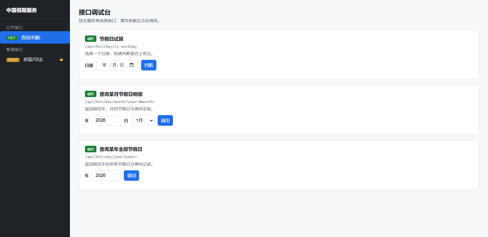
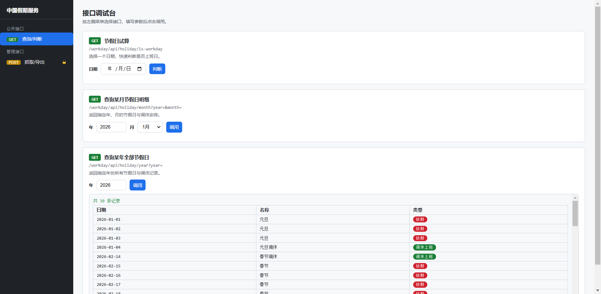
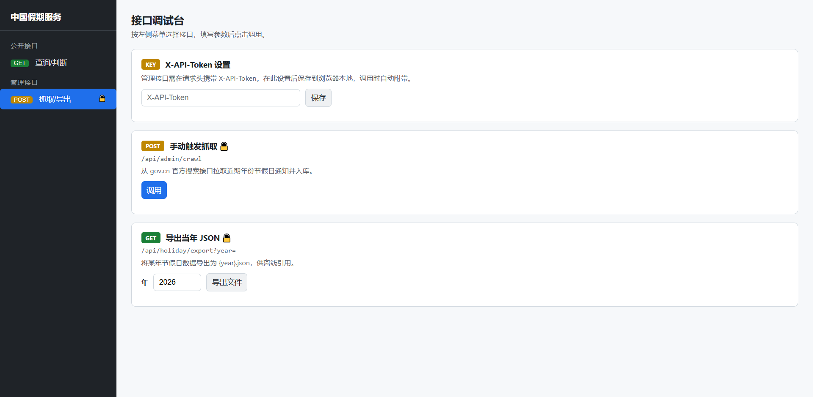

# china-workday

法定节假日 / 中国节假日 / 工作日判断公共服务（Spring Boot 3.2.5 / Java 17）。

- **坐标**：`ict:china-workday:1.0.0`，包名 `ict.china.workday`
- **功能**：从国务院官方搜索数据接口（gov.cn「政策文件库」）获取「部分节假日安排的通知」，解析放假与调休日期入库（PostgreSQL），提供 HTTP 接口判断某日是否上班日，支持按年份导出 JSON 离线使用。
- **代码仓库**：Gitee ｜ **发布仓库**：阿里云效 Packages（Maven）

> **抓取源说明**：gov.cn 政策文件库列表页（`/zhengce/zhengceku/`）对部分网络环境返回 403 且为 JS 动态渲染。本项目改用其**官方搜索 JSON 数据接口**（`sousuo.www.gov.cn/search-gov/data`，`type=gwyzcwjk` 政策文件库检索）获取各年份通知详情 URL，再抓取详情页解析。搜索接口返回失败时自动回退为列表页抓取。

## 快速开始（本地）

要求：JDK 17、Maven 3.6+、PostgreSQL（或用 Docker 起库）。

```bash
# 1. 建库（假设本机 PG 已启动）
createdb chinaworkday -U chinaworkday   # 或用 deploy/db/init-user-db.sh

# 2. 配置（环境变量）
export DB_USER=chinaworkday
export DB_PASSWORD=chinaworkday
export DB_URL=jdbc:postgresql://localhost:5432/chinaworkday
export CHINA_WORKDAY_API_TOKEN=your-token

# 3. 运行（本地连 PG，使用 dev profile）
mvn spring-boot:run -Dspring-boot.run.profiles=dev
```

启动后：
- 管理页：<http://localhost:8080/>（需 Token）
- 判断接口：`GET /workday/api/holiday/is-workday?date=2026-02-14`

## Docker 部署

```bash
cd deploy
cp .env.example .env   # 编辑填充 DB_PASSWORD 与 CHINA_WORKDAY_API_TOKEN
docker compose up -d --build
```

注意：`CHINA_WORKDAY_API_TOKEN` 未设置时容器将启动失败（快速失败，符合凭据安全原则）。

## 对外接口

统一返回 `{ code, message, data }`；写/管理/导出接口需在请求头携带 `X-API-Token`。

| 方法 | 路径 | 说明 | 鉴权 |
|---|---|---|---|---|
| GET | `/workday/api/holiday/is-workday?date=2026-02-14` | 判断是否上班日 | 公开 |
| GET | `/workday/api/holiday/month?year=2026&month=2` | 某月节假日明细 | 公开 |
| GET | `/workday/api/holiday/year?year=2026` | 某年全部节假日/调休 | 公开 |
| GET | `/workday/api/holiday/export?year=2026` | 导出 `{year}.json` | Token |
| POST | `/workday/api/admin/crawl` | 手动触发抓取 | Token |
| GET | `/` | 内置管理页 | 页面 |

`is-workday` 响应示例：

```json
{ "code": 200, "message": "ok",
  "data": { "date": "2026-02-14", "isWorkday": true, "dayType": "WORKDAY", "holidayName": "春节调休" } }
```

## 上班日判断口径

某日期 `d` 是上班日 ⟺
`( d ∈ 周一~周五 且 d ∉ HOLIDAY )` 或 `( d ∈ 周六/周日 且 d ∈ WORKDAY 调休上班 )`。

## 离线数据（导出 JSON）

引用方可持续关注节假日数据：调用 `/workday/api/holiday/export?year=2026` 获得 `2026.json`，放入自身 `resources` 中离线使用。

## 发布到阿里云效 Packages（Maven）

Maven 发布坐标已在 `pom.xml` 的 `<distributionManagement>` 预置（仓库 `id` 为 `aliyun-packages`），`url` 为占位符，需替换为你的云效仓库地址，并在 `~/.m2/settings.xml` 提供凭据：

```xml
<settings>
  <servers>
    <server>
      <id>aliyun-packages</id>
      <username>你的云效登录名</username>
      <password>你的云效访问令牌</password>
    </server>
  </servers>
</settings>
```

发布命令：

```bash
mvn clean deploy
```

> 仓库实际 `id/url` 与认证凭据属于用户侧配置，本文档不代填；请按阿里云效 Packages 控制台「仓库指南」填入 `pom.xml` 与 `settings.xml`。

## 配置项

| 前缀 | 键 | 说明 | 默认 |
|---|---|---|---|
| `china-workday.app` | `api-token` | 管理/写/导出接口鉴权 token（L4 凭据） | 必填 |
| `china-workday.crawl` | `enabled` | 是否启用抓取 | `true` |
| `china-workday.crawl` | `on-startup` | 启动时抓取一次 | `true` |
| `china-workday.crawl` | `search-url` | 官方搜索数据接口 | `/search-gov/data` |
| `china-workday.crawl` | `search-keyword` | 搜索关键字 | `部分节假日安排的通知` |
| `china-workday.crawl` | `search-page-size` | 搜索返回条数 | `20` |
| `china-workday.crawl` | `year-back-offset` | 保留年份向前偏移（含当前年） | `1` |
| `china-workday.crawl` | `year-forward-offset` | 保留年份向后偏移 | `1` |
| `china-workday.crawl` | `list-url` | 列表页 URL（回退通道） | gov.cn 政策文件库 |
| `china-workday.crawl` | `cron` | 定时监控 cron | `0 0 8 * * *` |
| `china-workday.crawl` | `timeout-millis` | 抓取超时（ms） | `10000` |

## 测试

```bash
mvn test
```

覆盖：上班日判断核心（HOLIDAY/WORKDAY/普通周末/普通工作日）、接口正/反/边界用例、节假日文本解析规则、**基于 gov.cn 真实 2026 通知页面的解析验证**（含「省略月份区间」「并列上班日」等实际格式）。

## 安全

- 管理/写/导出接口强制 `X-API-Token`，缺失或错误返回 401（无降级放行）。
- 抓取仅允许 `gov.cn` 白名单域名，DNS 解析后校验为公网 IP，阻断私有/环回/元数据地址；重定向受限。
- 所有 SQL 使用参数化查询；错误响应统一格式，不暴露堆栈/内部结构；日志不记录 token。

## 界面截图

内置管理页面位于 `src/main/resources/static/index.html`，是一个单页接口调试台。

*公开接口面板：日期判断、月查询、年查询*





*管理接口面板：Token 设置、手动抓取、导出 JSON*



